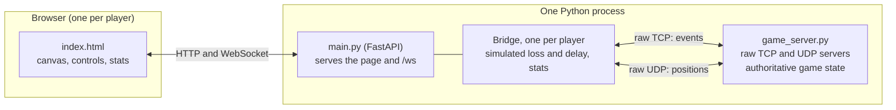
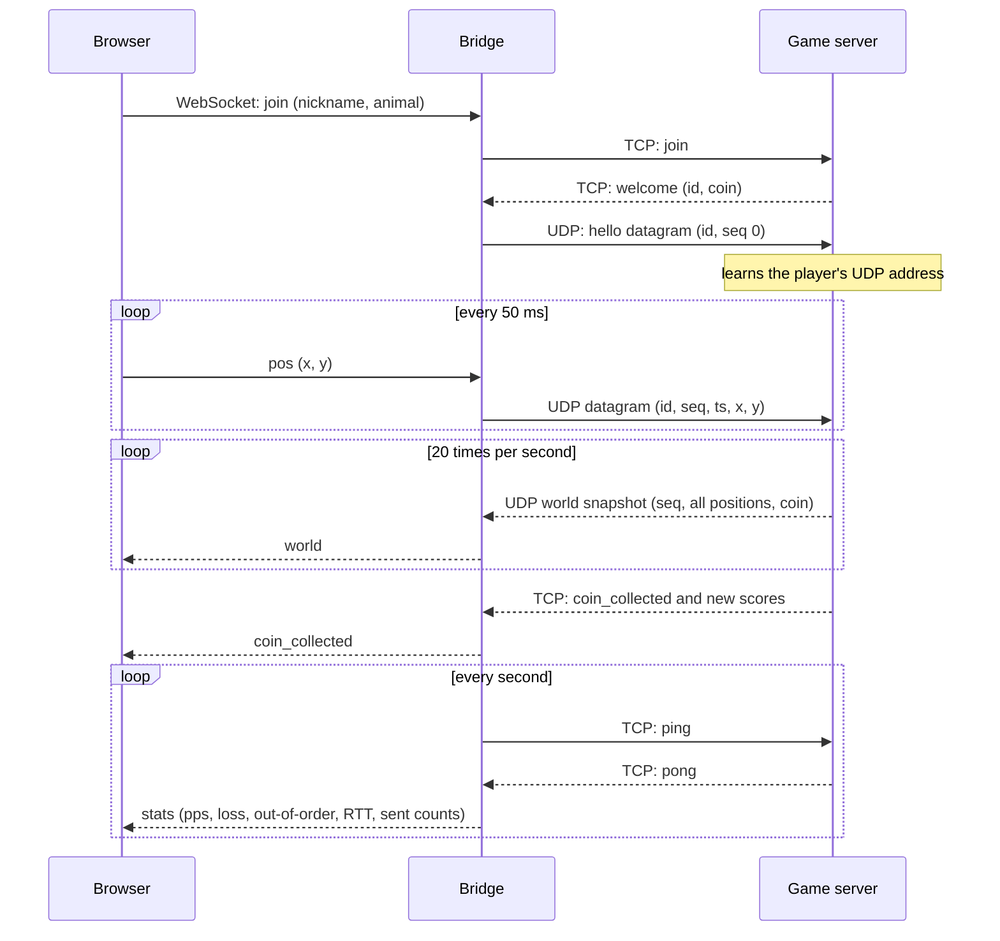

# TCP vs UDP Coin Grab

A small multiplayer browser game that makes the difference between **TCP** and **UDP** visible. Players pick an animal, run around a shared arena and race for a coin, while a live panel shows what each protocol is doing: packets per second, loss, out-of-order packets and round-trip time.

Everything the game server does uses **raw Python sockets** (`socket`, `threading`, `json`). A thin FastAPI layer lets ordinary browsers take part, because browsers cannot open raw TCP or UDP sockets.

> Educational demo. Network loss and delay are **simulated** (and labelled as such in the UI), see [Simulated vs real](#simulated-vs-real).

## Features

- **Two transports side by side.** TCP carries reliable events, UDP carries fast position updates.
- **Live switch.** Each player can move their positions between UDP and TCP while playing and watch the effect.
- **Network conditions you can dial in (simulated).** UDP loss 0-50%, extra UDP delay and extra TCP delay, 0-500 ms.
- **Real, measured stats.** Packets per second, loss % from sequence-number gaps, out-of-order count, TCP RTT from ping/pong, and messages sent over each protocol.
- **Server-authoritative game.** The server owns positions, collision checks and scores.
- **13 animal characters** chosen in a start popup, each with a coloured glow underneath.
- **Works on phones.** Touch and drag in the arena to move; keyboard on desktop.
- **No build step.** One static `index.html` (vanilla JS and CSS), no database, no Docker.

## How it works

### System overview

Everything runs in **one Python process**, so it deploys as a single service.



- **`game_server.py`** runs two raw socket servers in background threads: TCP (`SOCK_STREAM`, default port 9000) and UDP (`SOCK_DGRAM`, default port 9001). It holds the game state and runs a 20 Hz tick loop.
- **`main.py`** serves `index.html` and exposes one WebSocket endpoint, `/ws`. For every connected player it creates a **bridge** that opens that player's *own* raw TCP socket and *own* raw UDP socket to the game server on `127.0.0.1` and forwards messages in both directions.
- **`index.html`** draws the arena on a canvas, handles input, and shows the stats, event log and chat.

ASCII version, for readers outside GitHub:

```
 Browser  <--WebSocket-->  Bridge (FastAPI)  <--raw TCP-->  Game server
 (canvas)                  one per player    <--raw UDP-->  (authoritative state)
                           + simulated loss/delay
                           + stats
```

### Life of a player



1. **Join.** After the player picks a character and presses Start, the browser opens the WebSocket and sends `join`. The bridge forwards it over TCP. The server replies with `welcome` and broadcasts the updated lobby list.
2. **UDP hello.** UDP has no connection, so the bridge sends a first datagram carrying the player's id. The server learns the player's UDP address from it and sends world updates there.
3. **Moving.** The browser sends its position 20 times a second. The bridge applies the simulated impairment and forwards it over UDP (or TCP, in TCP mode).
4. **Server tick.** Every 50 ms the server sends each player a snapshot of all positions plus the coin.
5. **Collision.** On every incoming position the server checks the distance to the coin. If the player is close enough, the server awards a point, moves the coin, and broadcasts `coin_collected` with the new scores over TCP.
6. **Stats.** The bridge pings over TCP once a second and pushes a stats message to the browser.

### What each protocol carries, and why

| | TCP | UDP |
|---|---|---|
| **Carries** | join, leave, nickname, animal, chat, coin collected, scores, lobby list, ping/pong | player positions, 20 Hz world snapshots |
| **Why** | These must arrive, exactly once, in order. | A lost position is replaced by the next one 50 ms later, so retransmitting it would only add lag. |
| **Framing** | Newline-delimited JSON. A buffer handles partial and merged reads, because TCP is a byte stream. | One datagram is one message, small JSON. |
| **Ordering** | Guaranteed by TCP. | Not guaranteed. Each datagram has a per-sender sequence number and timestamp, and the server drops stale ones. |

### Position mode (UDP or TCP)

Each player has a mode, switchable live from the UI:

- **UDP mode:** positions go to the server over UDP, and world snapshots come back over UDP.
- **TCP mode:** positions go over the TCP stream, and snapshots come back over it too.

The server accepts positions on either transport. The mode only decides which one is used, so switching never freezes movement. Try UDP with 30% loss, then TCP with 300 ms delay, and compare how the arena feels.

### Simulated network conditions

The sliders are applied **in the bridge, per player**, and are labelled "simulated" everywhere:

- **UDP loss:** each datagram is dropped with the chosen probability, in both directions (positions to the server, snapshots back).
- **UDP delay:** each datagram is delayed independently, so packets can overtake each other after you change the slider.
- **TCP delay:** messages are delayed *in order* through a queue. A slow message holds back everything behind it, which models TCP's head-of-line blocking. TCP loss is not simulated, because real TCP would retransmit and hide it.

### How the stats are computed

| Stat | Source |
|---|---|
| UDP packets/s | World datagrams that actually arrived at the bridge in the last second (after simulated loss and delay) |
| Loss % | Gaps in the server's per-player sequence numbers over the last second |
| Out of order | Datagrams that arrived after a newer sequence number (running total) |
| TCP RTT | Ping/pong round trip over the player's own TCP connection. It includes the simulated TCP delay in both directions |
| Sent over TCP / UDP | Messages the bridge sent to the server on each protocol (pings included) |

### The arena in the browser

- The arena is 800 x 500. One coin exists at a time and respawns randomly after a pickup.
- Your own character moves immediately (local prediction). A **dashed outline** shows where the server last saw you, which makes delay and loss visible.
- Other players are smoothed slightly, so jitter is visible but not painful.
- Each character has a coloured **glow on the floor**, and yours also gets a white ring.

## Project structure

```
.
├── game_server.py     raw TCP + UDP game server (state, collisions, tick loop)
├── main.py            FastAPI app: serves index.html, WebSocket bridge, simulation, stats
├── index.html         whole frontend: HTML, CSS, JS, SVG characters
├── test_client.py     terminal client using raw sockets (no browser needed)
├── requirements.txt   fastapi, uvicorn[standard]
├── Procfile           start command for Railway
├── runtime.txt        Python version
└── README.md
```

## Run locally

Requires Python 3.11 or newer.

```bash
git clone https://github.com/<your-username>/<your-repo>.git
cd <your-repo>
pip install -r requirements.txt
uvicorn main:app --port 8000
```

Open <http://localhost:8000> in two browser tabs, pick a character in each, and play.

**Play with others on your network:** start with `uvicorn main:app --host 0.0.0.0 --port 8000` and have them open `http://<your-LAN-IP>:8000`.

### Controls

- **Desktop:** arrow keys or WASD.
- **Phone or tablet:** touch and drag anywhere in the arena. The distance from your first touch sets your speed. Touch outside the arena to scroll the page.

### Terminal test client

Run the game server alone and watch the protocols without a browser:

```bash
python game_server.py
python test_client.py --nick alice               # positions over UDP
python test_client.py --nick bob --mode tcp      # positions over TCP
```

The client prints every TCP event, per-second UDP stats (packets/s, loss, out-of-order) and TCP ping RTT.

## Configuration

| Variable | Default | Meaning |
|---|---|---|
| `PORT` | set by the host | Web port that uvicorn listens on (Railway sets it) |
| `GAME_TCP_PORT` | `9000` | Raw TCP port of the game server |
| `GAME_UDP_PORT` | `9001` | Raw UDP port of the game server |
| `GAME_HOST` | `127.0.0.1` | Address the game server binds to |

## Deploy on Railway

1. Push the project to a GitHub repository.
2. On [railway.com](https://railway.com), create a new project and choose **Deploy from GitHub repo**, then select the repository.
3. Railway detects Python from `requirements.txt` and starts the app with the `Procfile` command:
   `uvicorn main:app --host 0.0.0.0 --port $PORT`
4. In the service, open **Settings, then Networking, then Generate Domain** to get a public URL.

Notes:

- Only the web port is public. The game's TCP and UDP ports stay **inside the container** on `127.0.0.1`, which is all this design needs.
- Run **a single instance**. Game state lives in memory, so a second copy would be a separate game.
- Every push to the connected branch redeploys automatically.
- Railway's plans and limits change over time, so check their current terms.

## Simulated vs real

**Real:**
- Raw TCP and UDP sockets, with real framing for the TCP byte stream.
- Per-datagram sequence numbers and timestamps, and stale-packet rejection on the server.
- Loss %, out-of-order count and packets/s, all measured from the real packets that arrive.
- TCP RTT from real ping/pong messages.
- Server-side collision checks and scoring.

**Simulated:**
- UDP loss, UDP delay and TCP delay, applied inside the bridge.

**Why simulate?** The bridge and the game server talk over `127.0.0.1` (loopback), where UDP almost never drops or reorders packets. Without the simulator, UDP would look just as perfect as TCP and there would be nothing to compare.

**Also worth knowing:**
- The browser-to-bridge WebSocket runs over TCP, so that leg is always reliable. The TCP/UDP comparison happens between the bridge and the game server.
- Real UDP across the internet is not exposed here, because most hosting platforms only expose the web port.

## Limitations

- One shared arena. No rooms, accounts or authentication.
- State is in memory and is lost on restart.
- Designed for a handful of players, not for scale.
- The server accepts the positions clients report (it checks the coin, but it does not validate speed), so this is not cheat-proof.

## Tech stack

Python 3.11+, FastAPI, uvicorn, standard-library `socket` / `threading` / `asyncio` / `json`, and a single static `index.html` with vanilla JS, CSS and inline SVG. No frameworks, no build step.
